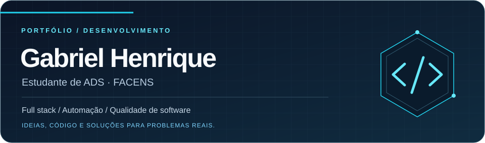
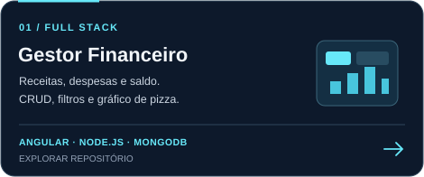
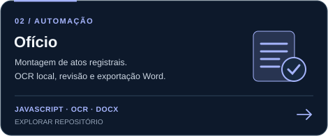
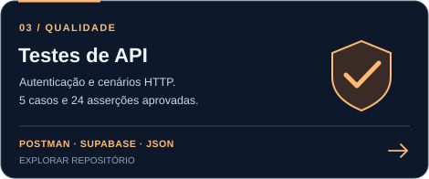
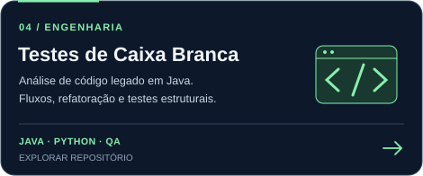

  
  

## Sobre mim

Sou estudante de **Análise e Desenvolvimento de Sistemas na FACENS** e trabalho na área cartorária. Gosto de transformar problemas do dia a dia em soluções tecnológicas, especialmente quando envolvem automação, organização de informações e desenvolvimento de sistemas.

Aqui compartilho projetos acadêmicos, experimentos e aplicações que venho construindo e testando. Meu foco é evoluir em desenvolvimento full stack, integração de APIs, bancos de dados e qualidade de software.

## Projetos em destaque

  
  
  
  

### Outros projetos

| Projeto | O que explorei |
| --- | --- |
| [Qual é a Boa?](https://github.com/gabrieldolly11/qual-e-a-boa) | Projeto acadêmico em equipe com proposta de descoberta de eventos e experiências locais. |
| [FinançApp](https://github.com/gabrieldolly11/projeto_calculadora/tree/Refatoracao) | Calculadora Java, refatoração, JavaDoc e testes unitários. |
| [Catálogo de filmes](https://github.com/gabrieldolly11/AC1-Desenvolvimento-Angular) | Componentes Angular, favoritos e registro de visualizações. |

## Tecnologias e ferramentas

 

 

## O que estou desenvolvendo

- Aplicações web com front-end, API REST e banco de dados.
- Ferramentas de automação documental com revisão humana.
- Testes de software, documentação técnica e boas práticas de desenvolvimento.

---

**Vamos trocar ideias?** [Conecte-se comigo no LinkedIn.](https://www.linkedin.com/in/gabriel-henrique-6329b525b/)
